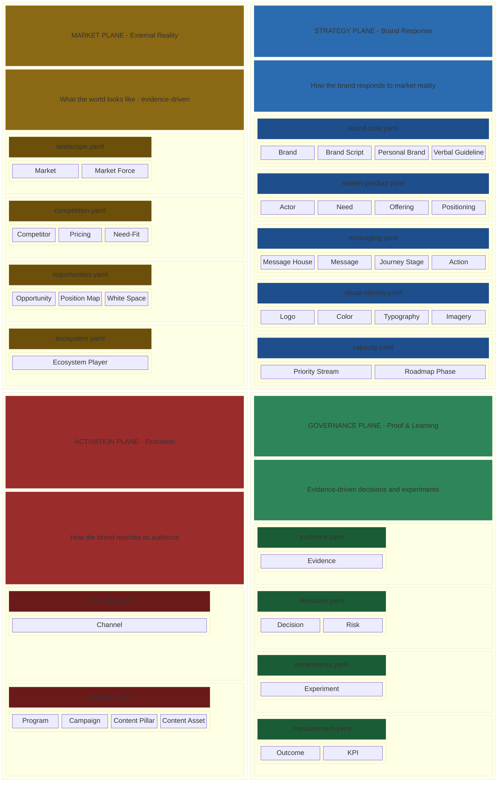
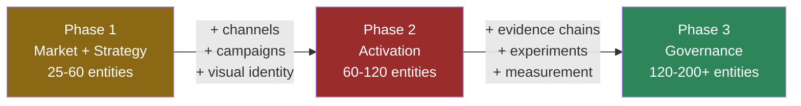

# Archally Brandvoice Schema

YAML-based schema for brand communication strategy modeling - market reality, brand identity, messaging architecture, activation planning, and governance in a single machine-readable format.

[](./LICENSE)

## The Problem

Brand strategy fragments across slide decks, Google Docs, agency briefs, Notion boards, and tribal memory. When a team needs to make a positioning decision - launch a campaign, respond to a competitor, enter a new market - they spend days reconstructing context that should already be explicit. Messaging drifts from strategy within weeks. New team members and agency partners spend months absorbing brand knowledge that could be structured and navigable.

The cost is not missing documentation. It is fragmented brand truth.

## The Approach: Brand Cartography

Archally treats brand communication the way cartographers treat territory - by surveying it methodically, representing it at multiple scales, layering concerns into separate planes, and marking what remains unknown.

| Cartography | Brandvoice equivalent |
|---|---|
| **Map layers** (topographic, political, transport) | **Four planes** - Market, Strategy, Activation, Governance - toggle layers over the same brand |
| **Legend and symbology** | **Metamodel** - typed IDs (`BRD001`, `ACT001`, `CPR001`) make the model machine-readable |
| **Survey and triangulation** | **Evidence chains** - claims are triangulated from research, not asserted |
| **Terra incognita** | **Confidence levels** (`hypothesis`, `weak-signal`, `moderate`, `strong`) - honest about what is not yet proven |
| **Scale / zoom levels** | **Abstraction levels** - from market landscape down to individual campaign assets |
| **Nautical charts** (hazard markers) | **Governance artifacts** - risks, pending experiments, and unresolved decisions surfaced before they cause damage |

## What is a Brandvoice?

A brandvoice is a **single formal model** of a brand's communication strategy - one source that captures what the market looks like, how the brand responds, how it activates, and how it proves what works. It replaces scattered artifacts with a structured, validated, version-controlled specification:

- **Market Plane** (external reality): markets, forces, competitors, opportunities, ecosystem players, position maps
- **Strategy Plane** (brand response): brand identity, actors, needs, offerings, positioning, messaging architecture, visual identity, capacity planning
- **Activation Plane** (execution): channels, campaigns, programs, content pillars, content assets
- **Governance Plane** (proof and learning): evidence, decisions, risks, experiments, measurable outcomes

### One model, many outputs

A single brandvoice can drive multiple generated artifacts - brand strategy reports, competitive landscape maps, message house visualizations, campaign briefs, positioning matrices - all from the same source. When the model changes, every output stays consistent.

### Built for humans and AI agents

Every schema field carries a machine-readable `description`. AI agents consume brandvoice models as structured domain context via MCP servers - not retrieval over documents, but deterministic graph queries against a validated formal model. The same brandvoice that onboards a new team member also grounds an AI agent's reasoning about brand strategy.

### Local-first, version-controlled

Brandvoice models are plain YAML files in your Git repository. No cloud upload required, no vendor platform, no infrastructure. Your brand strategy - which encodes your competitive positioning, messaging decisions, and market evidence - stays under your control.

## Quick Start

**1. Inspect the model layout** (`.brandvoice/v1.8/`):

```
my-brand/
  .brandvoice/v1.8/
    brandvoice.yaml
    market/
      landscape.market.yaml
    governance/
      evidence.governance.yaml
```

**2. Write a minimal brandvoice** (three files). These named blocks are checked by `npm run doc-snippets`:

### `brandvoice.yaml`

```yaml
version: "1.0.0"
schemaVersion: "1.8.0"
name: "My Brand"
description: "A brief summary of brand scope and market context."
scope: my-brand
tags: [saas, b2b]
```

### `market/landscape.market.yaml`

```yaml
version: "1.0.0"
markets:
  - id: MKT001
    name: "Primary Market"
    category: "Market category"
    description: "Description of the market you operate in."
    maturity: growing
    evidence_refs: [EVD001]
```

### `governance/evidence.governance.yaml`

```yaml
version: "1.0.0"
evidence:
  - id: EVD001
    title: "Market sizing report"
    type: secondary-research
    date: "2026-01-15"
    summary: "The market grows and buyers are switching tools."
    confidence: moderate-evidence
    supports: [MKT001]
```

**3. Install and check** from a clone of this repository (Node.js 20 or later):

```bash
git clone https://github.com/archally/brandvoice-schema.git
cd brandvoice-schema
npm ci
npm run validate:examples
npm run build
npm run doc-snippets
npm run atlas:check
```

To validate your own files, run `npm run validate -- /path/to/my-brand/.brandvoice/v1.8 --schemas schema/v1.8`. The validator defaults to the shipped schemas and can select a matching installed schema line from the model path. The minimal model passes with one gap warning, because it has no activation plane yet.

**4. Explore the worked examples:**

```bash
npm run validate:examples   # validate both examples against schema/v1.8
npm run build               # compile the model builder and semantic checker
npm run check:examples      # run the semantic rules on both examples
npm run model -- examples/fitness-app/.brandvoice/v1.8 --stats
```

## Included tools and documentation

[Tool commands](tools/README.md), [file conventions](docs/file-conventions.md), [modeling guide](docs/modeling-guide.md) and the [schema atlas](docs/schema-atlas/2026-11-05-reference.md) describe the shipped release. Run `npm run atlas` to regenerate the reference, `npm run atlas:check` to detect drift and `npm run docs:check` to check the documentation boundary.

## Architecture

> **METAMODEL** (cross-cutting) - typed IDs · versioning · evidence chains · geo scope · framework profiles



The Market Plane captures external reality - competitive landscape, market forces, and opportunities that exist regardless of the brand. The Strategy Plane captures the brand's deliberate response - identity, positioning, messaging, and visual system. The Activation Plane bridges strategy to execution - channels, campaigns, and content. The Governance Plane captures proof and learning - evidence, decisions, experiments, and measurable outcomes.

## Usage Modes

### Greenfield - New Brand

Start from scratch with a Minimal Viable Brandvoice (MVB):

1. Research the market landscape and competitors
2. Define brand identity and positioning
3. Build messaging architecture and journey stages
4. Add activation channels and campaign structure
5. Layer in evidence and governance

Start small (10-25 entities), validate, then grow through phases.

### Brownfield - Existing Brand

Model an existing brand by analyzing what's already in place:

1. Enumerate existing brand assets, messaging, and channels
2. Map competitive landscape from market research
3. Structure implicit positioning into explicit strategy
4. Link evidence to strategic claims

### Iterative Modeling

Brandvoice models grow through three phases:

| Phase | Focus | Entity count |
|-------|-------|-------------|
| **Phase 1** | Market + Strategy core: competitors, actors, needs, brand, positioning, messaging | 25-60 |
| **Phase 2** | Activation + detail: channels, campaigns, visual identity, ecosystem | 60-120 |
| **Phase 3** | Governance + depth: evidence chains, experiments, measurement, capacity | 120-200+ |



## Schema Files

| Plane | Schema | Entity types |
|-------|--------|-------------|
| Cross-cutting | `metamodel.schema.yaml` | Typed ID patterns, versioning, geo scope, shared definitions |
| Cross-cutting | `migration.schema.yaml` | Model evolution: entity, property, relationship, meta changes |
| Market | `market/landscape.schema.yaml` | Markets (MKT), Market Forces (MFR) |
| Market | `market/competition.schema.yaml` | Competitor Profiles (CPR) with pricing, need-fit, competitive moves |
| Market | `market/opportunities.schema.yaml` | Opportunities (OPP), Position Maps (PM), White Spaces (WSP) |
| Market | `market/ecosystem.schema.yaml` | Ecosystem Players (EPL) - partners, co-presenters, coopetition |
| Strategy | `strategy/brand-core.schema.yaml` | Brands (BRD), Brand Scripts (BSC), Personal Brand Profiles (PBP), Verbal Guidelines (VRB) |
| Strategy | `strategy/market-product.schema.yaml` | Actors (ACT), Needs (NED), Offerings (OFF), Competitors, Positioning (POS), Contexts (CTX) |
| Strategy | `strategy/messaging.schema.yaml` | Message Houses (MHS), Messages (MSG), Journey Stages (JS), Actions, Outcomes |
| Strategy | `strategy/visual-identity.schema.yaml` | Logo Systems, Color Palettes, Typography, Imagery, Iconography |
| Strategy | `strategy/capacity.schema.yaml` | Priority Streams (PRI), Roadmap Phases (RMP) |
| Activation | `activation/channels.schema.yaml` | Channels (CHN) with actor/context/journey links |
| Activation | `activation/campaigns.schema.yaml` | Programs (PRG), Campaigns (CMP), Content Pillars (CPL), Content Assets |
| Governance | `governance/evidence.schema.yaml` | Evidence Records (EVD) with source metadata and geo scope |
| Governance | `governance/decisions.schema.yaml` | Decisions (DEC), Risks (RSK) |
| Governance | `governance/experiments.schema.yaml` | Experiments (EXP) |
| Governance | `governance/measurement.schema.yaml` | Measurable Outcomes, KPIs |

## File Naming Convention

Brandvoice models use a `{semantic-stem}.{plane}.yaml` naming convention:

```
.brandvoice/v1.8/
  brandvoice.yaml                        # Root metadata
  market/
    landscape.market.yaml                # Markets, forces
    direct.competition.market.yaml       # Direct competitors
    substitutes.competition.market.yaml  # Substitute competitors
    opportunities.market.yaml            # Opportunity thesis
  strategy/
    brand-core.strategy.yaml             # Brand identity
    audiences.market-product.strategy.yaml
    messaging.strategy.yaml              # Message houses
  activation/
    channels.activation.yaml
    content.campaigns.activation.yaml
  governance/
    competitive.evidence.governance.yaml
    market.evidence.governance.yaml
    decisions.governance.yaml
```

Scoped entity IDs prevent collisions across files: `market.CPR001`, `strategy.NED004`, `governance.EVD012`.

## Best Practices

1. **Evidence-first, not assertion-first.** Every market claim, competitive comparison, and positioning statement should link to evidence records. Claims without evidence are hypotheses, not facts.

2. **Multiple small files over monoliths.** Split by semantic cluster - direct competitors in one file, substitutes in another. Seven 100-line files reveal structure better than one 700-line file.

3. **Scoped IDs for multi-file models.** Use `{semantic-group}.PREFIX###` format (e.g., `market.CPR001`) to prevent ID collisions when splitting across files.

4. **Confidence levels on governance.** Tag evidence with `hypothesis`, `weak-signal`, `moderate`, `strong`, or `definitive`. Be honest about what you know vs. what you assume.

5. **Defer aggressively.** Visual identity and capacity planning are Phase 3 - don't model them before market and strategy are stable.

## Versioning

This package follows [SemVer](https://semver.org/):
- **Major** (2.0.0): breaking schema changes
- **Minor** (1.8.0): new optional fields, entity types or relaxed constraints
- **Patch** (1.6.2): documentation, clarification, validator fixes

## Ecosystem

Brandvoice Schema is the open foundation of the [Archally](https://archally.pro) brand strategy platform.

**Archally's approach:** One formal model drives everything. Instead of maintaining separate brand books, competitive analyses, campaign briefs, and agency decks - teams build one brandvoice that generators consume to produce strategy reports, competitive maps, messaging matrices, and campaign briefs. The model is the single source of truth.

**For AI-augmented teams:** Archally MCP servers expose brandvoice models as structured grounding for AI agents - deterministic graph queries against a validated brand model, not retrieval over unstructured documents. Agents get typed entities, traced relationships, and evidence-backed claims at inference time.

The schema itself is Apache 2.0-licensed and can be used independently of Archally tooling.

### Archally Pro

The commercial viewer, generators, MCP servers and `bv` CLI are separate products; they do not ship in this repository. Available at [archally.pro](https://archally.pro):

| Category | Capabilities |
|----------|-------------|
| **Brand Strategy Viewer** | Interactive graph with force-directed layout, plane filtering, entity search, and relationship inspector |
| **Report Generators** | Brand strategy reports, competitive landscape maps, positioning matrices - generated from the model |
| **MCP Servers** | Structured grounding for Claude, Cursor, and other AI agents. 21 MCP tools for deterministic brand model queries |
| **Brandvoice CLI (`bv`)** | Query, validate and navigate brand models; edit model files with validation before writing |

## Contributing

Issues and discussions are welcome. For schema change proposals, please open an issue describing the use case before submitting a PR - schema changes affect all downstream consumers.

## License

**Dual-licensed** - [LICENSE](./LICENSE) is the authoritative map, and
[tools/LICENSE](./tools/LICENSE) names every tool directory. The schema, the examples and
the documentation are [Apache-2.0](./LICENSE-APACHE), and so is every tool that establishes
conformance or protects this distribution: the validator, port verifier, schema atlas and documentation snippet validator. The tools
that read a model for some other purpose - the model builder, semantic checker with
its rules, entity query and next-id helper - are [FSL-1.1-ALv2](./LICENSE-FSL), converting to Apache-2.0 two years after each
release.

The line is between conformance and judgement. Whether a model is *valid* and whether it is
the model that was published are properties of the format and must be freely exercisable by
anyone. Whether a model is *good* and what its edges mean are modeling opinions, and those
are the product. A directory in neither list is an omission, not a permission.

Copyright 2026 Adam Walkowski
